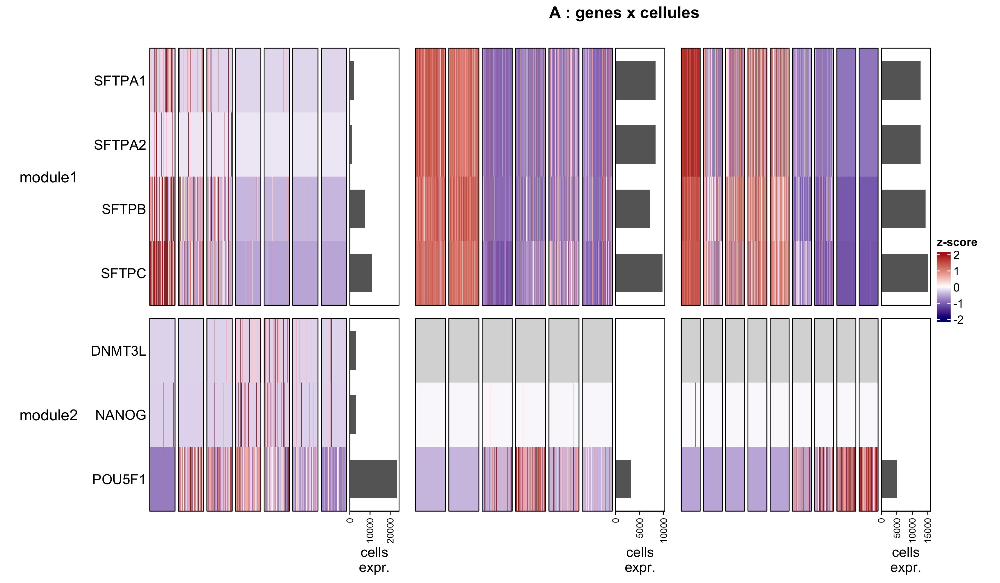
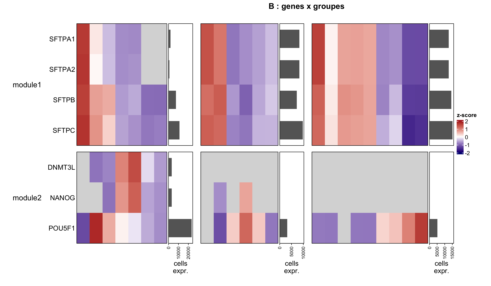
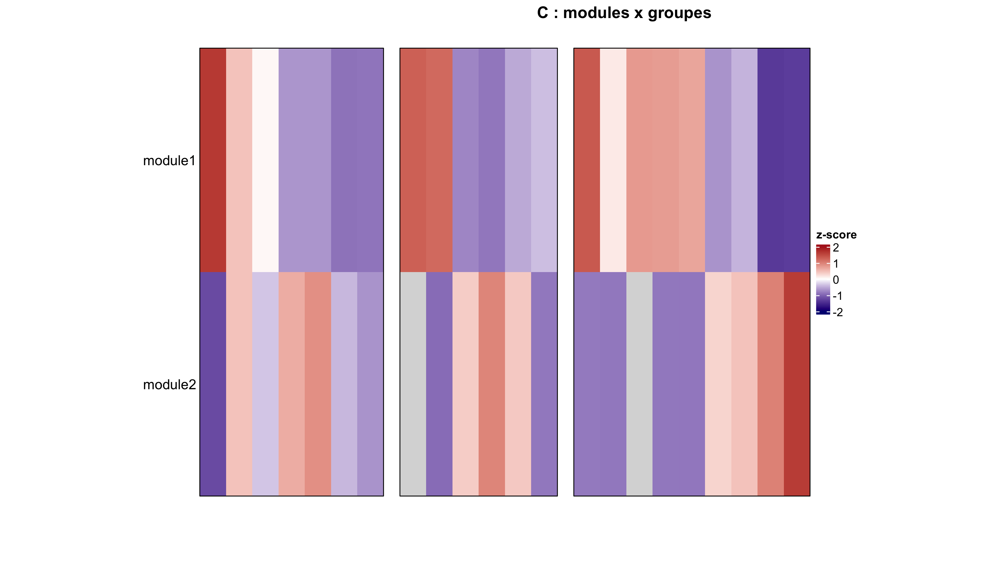

# CrossHeat

**Cross-species heatmaps of gene modules from single-cell data.**

Compare the expression of the same gene modules (e.g. housekeeping, T cell, myeloid) across several Seurat objects from **human and mouse**, side by side, in one figure. Gene symbols are mapped between species through an ortholog table computed once, so the rows of every heatmap are the same genes in the same order.

<!--
This is how you comment out your code
-->

<p align="center">
  
  
  
  
</p>


## Features

- One call draws all datasets side by side, with a shared colour scale.
- **Three views** of the same data:

  | View | Rows | Columns | Notes |
  |------|------|---------|-------|
  | **A** | genes | cells | random sample of cells per group, group names under each block |
  | **B** | genes | groups | average expression, **grey tile** if fewer than `min_n` cells express the gene |
  | **C** | modules | groups | mean z-score of the genes of each module |

- Per-gene z-score with optional **clipping** (`clip`).
- Optional horizontal bar plot of the number of expressing cells (views A and B).
- Genes missing in at least one dataset are dropped and listed.
- **Flexible layout** (`flexible = TRUE`): the blocks stretch with the plot window.
- **Custom colours** for the heatmap (`colors`, `na_color`, `bar_color`) and optional coloured **tiles** per module (side) and per group (top).
- **No ortholog conversion** when all datasets have the same species (including a single dataset).
- Title, font sizes and column width are parameters.
- Optional **PNG export**, one file per view.
- The ortholog table can be reused (`map = out$map`), so g:Profiler is not queried again.

## Installation

```r
install.packages(c("remotes", "BiocManager"))
BiocManager::install(c("ComplexHeatmap", "orthogene"))
remotes::install_github("Yann-Tapponnier/CrossHeat")
```

Requires R >= 4.1 and Seurat >= 5 (the code reads the `data` layer).

## Quick start

```r
library(CrossHeat)

# 1. Datasets: Seurat object, species, metadata column that defines the groups.
#    The list names are used as block titles; the first dataset is the reference
#    for the row labels.
datasets <- list(
  Dataset1_human = list(obj = seurat_Obj1, species = "human", grp = "orig.ident"),
  Dataset2_mouse = list(obj = seurat_Obj2, species = "mouse", grp = "orig.ident"),
  Dataset3_mouse = list(obj = seurat_Obj3, species = "mouse", grp = "orig.ident")
)

# 2. Gene sets: HUMAN symbols, one vector per module (replace with your own genes)
genesets <- list(
  Module1_housekeeping   = c("GAPDH", "ACTB", "B2M", "PPIA", "RPLP0", "TBP"),
  Module2_T_cell        = c("CD3D", "CD3E", "CD3G", "CD2", "CD8A", "CD4", "IL7R"),
  Module3_myeloid       = c("CD14", "LYZ", "CD68", "CSF1R", "ITGAM", "LST1", "FCGR3A")
)

# 3. Run with the default parameters
out <- run_heatmaps(datasets, genesets)

# 4. Change only what you need
params <- list(versions = c("A", "C"), clip = 3, gene_size = 6,
               save_png = TRUE, out_dir = "figures")
out2 <- run_heatmaps(datasets, genesets, params, map = out$map)  # no new g:Profiler query

# 5. Stretching blocks, custom colours, tiles
out3 <- run_heatmaps(datasets, genesets,
                     list(flexible = TRUE, colors = c("royalblue", "white", "tomato"),
                          module_tiles = TRUE, group_tiles = TRUE,
                          group_colors = c(ctrl = "grey60", treated = "firebrick")),
                     map = out$map)

# 6. One species only: no ortholog conversion (genesets = symbols of that species)
run_heatmaps(list(Dataset2_mouse = datasets$Dataset2_mouse),
             list(Module2_T_cell = c("Cd3d", "Cd3e", "Cd2")))
```

A complete script listing **every parameter with its explanation** is installed with the package:

```r
file.show(system.file("examples", "run_heatmaps_example.R", package = "CrossHeat"))
```

### Standalone ortholog script

`Orthologue_Table()` is already included in the package, so `library(CrossHeat)` is enough. It is also provided as an independent script, to source at the beginning of a session:

```r
source("inst/scripts/Orthologue_Table.R")   # from a clone of the repository
# or, once the package is installed:
source(system.file("scripts", "Orthologue_Table.R", package = "CrossHeat"))
```

It keeps the genes of **both species** (columns `gene_human`, `gene_mouse`) and their module, which is what the heatmaps need.

## Arguments of `run_heatmaps()`

| Argument | Description |
|----------|-------------|
| `datasets` | named list; each element is `list(obj, species, grp)` (Seurat object, `"human"`/`"mouse"`, metadata column of the groups) |
| `genesets` | named list of **human** gene symbols, one vector per module |
| `params` | list of the parameters to override (table below); everything else keeps its default |
| `map` | ortholog table from a previous call (`out$map`); skips the ortholog query |

It returns invisibly `list(map = , res = )`: the ortholog table and the plotted matrices of each view.

## All parameters (`params`)

Defaults are shown; also available with `default_params()` and `?default_params`.

| Parameter | Default | Used by | Description |
|-----------|---------|---------|-------------|
| `versions` | `c("A","B","C")` | all | views to draw: `"A"` genes x cells, `"B"` genes x groups, `"C"` modules x groups; any combination |
| `ortho_method` | `"gprofiler"` | orthologs | `"gprofiler"`, `"homologene"` or `"babelgene"` |
| `ortho_non121` | `"keep_both_species"` | orthologs | how non one-to-one orthologs are handled (`non121_strategy` of `orthogene`) |
| `human_to_mouse` | `TRUE` | orthologs | `TRUE` if `genesets` are human symbols, `FALSE` if mouse (ignored when all datasets share one species) |
| `map_file` | `NULL` | orthologs | `.rds` path to save the ortholog table, `NULL` = no saving |
| `clip` | `2` | all | z-score clipped to `[-clip, clip]`, `NULL` = none; also sets the colour scale limits |
| `min_n` | `10` | B, C | minimum number of cells expressing a gene in a group, otherwise grey tile |
| `n_cells` | `200` | A | cells sampled per group |
| `seed` | `1` | A | random seed of the sampling |
| `flexible` | `FALSE` | all | `TRUE`: blocks stretch with the window (relative widths; `col_w` and the 60 mm of view A are ignored) |
| `show_n` | `TRUE` | A, B | bar plot of expressing cells (whole dataset) on the right |
| `title` | `"Module expression"` | all | figure title, `NULL` = no title |
| `title_version` | `TRUE` | all | append the view name to the title |
| `title_size` | `14` | all | title font size |
| `col_w` | `8` | B, C | width of one column, in mm (when `flexible = FALSE`) |
| `gene_size` | `8` | all | font size of the gene names (rows) |
| `col_size` | `9` | all | font size of column names (B, C) and group labels (A) |
| `colors` | `c("navy","white","firebrick")` | all | heatmap colours: low (`-clip`), middle (0), high (`+clip`); exactly 3 |
| `na_color` | `"grey85"` | all | colour of `NA` tiles (masked by `min_n`, or genes with no variance) |
| `bar_color` | `"grey40"` | A, B | colour of the bar plot of expressing cells |
| `module_tiles` | `FALSE` | all | coloured tile per module, on the left side of the first block |
| `group_tiles` | `FALSE` | all | coloured tiles per group, on top of every block |
| `module_colors` | `NULL` | all | named vector, e.g. `c(Module1 = "grey30")`; `NULL` = automatic; missing names get an automatic colour |
| `group_colors` | `NULL` | all | named vector, same logic; a group name has the same colour in every block |
| `tile_size` | `3` | all | thickness of the tiles, in mm |
| `save_png` | `FALSE` | all | save one PNG per view |
| `out_dir` | `"."` | PNG | output folder, created if needed |
| `file_prefix` | `"heatmap"` | PNG | files are `<out_dir>/<file_prefix>_<view>.png` |
| `png_width` | `12` | PNG | width in inches |
| `png_height` | `7` | PNG | height in inches (increase with many genes) |
| `png_res` | `300` | PNG | resolution in dpi |

## Notes and limits

- When datasets mix species, gene sets are given as **human** symbols. Genes without a mouse ortholog, or absent from one dataset, are dropped and printed.
- When **all datasets have the same species** (even a single one), nothing is converted: `genesets` must then be symbols of that species (e.g. `Cd3e` for mouse). Genes absent from a dataset are dropped and printed.
- Cell types or states defined in one species do not always map one-to-one onto the other species; interpret cross-species comparisons with care.
- Scores in view C are the mean of the clipped z-scores, which assumes each gene contributes equally. A rank-based score such as [UCell](https://github.com/carmonalab/UCell) could replace `module_score()`.
- Many genes in one figure need a taller PNG: increase `png_height` and lower `gene_size`.

## Development

```r
devtools::load_all()    # reload after each edit
devtools::document()    # regenerate NAMESPACE and man/
devtools::check()
```

## Citation

If you use CrossHeat, please cite this repository (add DOI / paper when available).

## Author

Yann Tapponnier

## License

MIT, see `LICENSE`.
